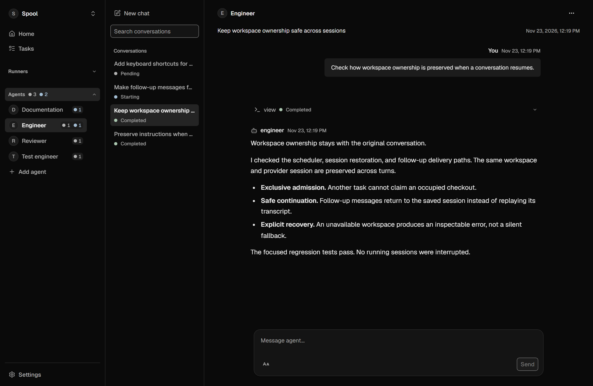

<p align="center">
  
</p>

<h1 align="center">Spool</h1>

<p align="center">
  <strong>A local-first workspace for coding agents.</strong><br>
  Projects, conversations, tasks, and automation in one native desktop app.
</p>

<p align="center">
  <a href="https://github.com/czearing/spool/releases/latest">Download for Windows</a>
  &middot; <a href="docs/getting-started.md">Getting started</a>
  &middot; <a href="docs/architecture.md">Architecture</a>
  &middot; <a href="CONTRIBUTING.md">Contributing</a>
</p>

<p align="center">
  <a href="https://github.com/czearing/spool/actions/workflows/desktop.yml"></a>
  <a href="https://github.com/czearing/spool/releases/latest"></a>
</p>



## Keep the work moving

Coding agents should not disappear into terminal tabs. Spool gives their work a
home: persistent conversations, inspectable task state, and a shared view across
your projects.

- **Work with agents, not terminal windows.** Keep instructions, model settings,
  conversations, and streamed tool activity together.
- **See what is happening.** Follow tasks from Incoming to In progress, Completed,
  or Failed, with logs and conversation history attached.
- **Continue the same conversation.** Follow up on completed work without
  rebuilding an agent's context from a transcript.
- **Opt into repeatable automation.** Experimental review, maintenance, and
  discovery workflows have explicit concurrency and workspace ownership.
  Runners are off by default; see [the runners flight](docs/getting-started.md#experimental-runners).
- **Keep state on disk.** Project-owned Markdown and JSON files hold agent
  definitions, queues, and logs. A Rust engine supervises execution; no database
  service is required.
- **Use the interface that fits.** A Tauri desktop app for daily work, with the
  same engine available through its CLI, terminal dashboard, and stdio MCP server.

Spool runs agents through GitHub Copilot. Your account, model access, repository
permissions, and local instructions still apply. Local-first describes where
Spool stores its state, not offline model inference.

## Get Spool

Download the Windows x64 installer from
[GitHub Releases](https://github.com/czearing/spool/releases/latest), open Spool,
and add a project. See [getting started](docs/getting-started.md) for agent setup
and your first conversation.

Prefer a terminal? See the [CLI and terminal dashboard guide](docs/cli.md).

**Windows is the currently packaged desktop platform.** Releases are unsigned, so
Windows may display a SmartScreen warning. Checksums are included with releases;
in-app automatic update installation is not enabled.

## Develop

You need Node.js 24, pnpm 11.25.0, Rust stable, and the Windows MSVC/Tauri build
prerequisites.

```powershell
git clone https://github.com/czearing/spool.git
cd spool
pnpm run bootstrap
pnpm dev
```

`pnpm dev` prepares the bundled runtime and opens Tauri. For browser development,
use `pnpm dev:web`; for components, use `pnpm storybook`. Development uses the
installed application's local data by default; tests use isolated fixtures.

See [Contributing](CONTRIBUTING.md) for setup, validation, and release commands.

## Find your way around

```text
apps/
  desktop/             React UI, native shell, and application backend
crates/
  spool/               Rust engine, CLI, terminal UI, and MCP server
  agent-prompts/       Shared instruction and workspace resolution
packages/
  runners/             Automation policies and repository integrations
  workflow/            Shared workflow contracts
docs/                  User guides, architecture, and design references
scripts/               Repository and Windows startup helpers
```

The desktop shell, application-owned runner workers, and project task daemons have
separate lifetimes. Closing a window does not terminate active agent work.
[Architecture](docs/architecture.md) explains the boundaries and
[the codebase map](docs/codebase-map.md) points to the right files.

## Contribute

Bug reports, reproducible examples, and focused improvements are welcome. Read
[the contribution guide](CONTRIBUTING.md) before opening a pull request, and keep
credentials, private prompts, and project logs out of public reports.
