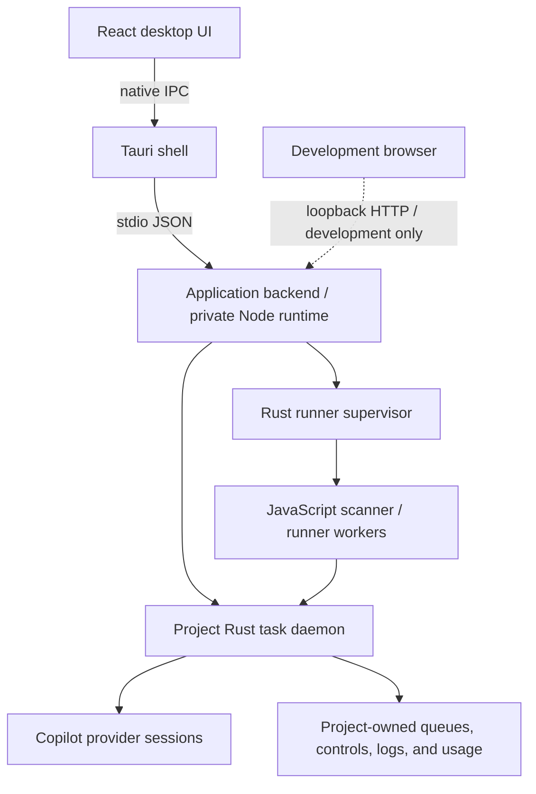

# Architecture

Spool is a local-first agent workspace with a native Windows desktop app. The
repository separates installable applications, Rust crates, supporting packages,
and project-owned runtime state.

## Runtime boundaries

The production desktop does not run an HTTP application server. The browser
adapter exists only for development and tests, and dispatches to the same backend
handlers as native IPC.

| Owner | Responsibility |
| --- | --- |
| React UI | Navigation, task views, agent conversations, settings, and components. |
| Tauri shell | Window/tray lifecycle, native integration, and the private backend process. |
| Application backend | API dispatch, project access, streaming, and application-owned runner coordination. |
| Rust runner supervisor | Worker startup, draining, retries, wakeups, and shutdown. |
| JavaScript runners | Scanner policy, workflow routing, and repository integrations. |
| Project task daemon | Task admission, exclusive session/workspace ownership, provider execution, and durable message delivery. |
| Copilot runtime | Provider session context and model/tool execution. |

The desktop application, runner workers, task daemon, and provider sessions are
not interchangeable processes. Closing the desktop must not terminate active
agent work. Source changes and replaced executables do not hot-update a running
daemon.

## Source boundaries

`apps/desktop` is one application: React/Vite, backend handlers, a development
adapter, Storybook, and its Tauri shell. The existing file-based API handlers live
under `src/app/api`; they are loaded by `backend/route-source.ts`, not Next.js.
`src/platform` is the frontend native/browser boundary.

`crates/spool` contains the CLI, terminal dashboard, MCP server, scheduler,
queue handling, provider integration, and native process supervision.
`crates/agent-prompts` resolves shared role instructions and workspace defaults
without depending on Tauri.

`packages/workflow` owns contracts shared across the desktop and runners.
`packages/runners` is a self-contained runtime bundle with its bridge, scanners,
and repository tooling. Its nested packages travel together; do not make an
installed runtime depend on a sibling source checkout.

The root Cargo workspace builds the engine and prompt library into `target`.
The Tauri shell is excluded from that workspace and retains its own lockfile,
release profile, and `src-tauri/target` output. This preserves the installer and
engine build contracts without coupling their dependency graphs.

## Data ownership

The application stores its registry and settings in the OS application-data
directory. A connected project's own directory stores agent Markdown, task JSON,
queues, logs, controls, and usage. Runtime data never belongs in the source tree
or an application resource bundle.

Task state is durable on disk. The daemon owns admission and queue transitions;
callers do not independently claim tasks. A daemon lease prevents duplicate
schedulers from recovering or dispatching the same project.

The work item owns delivery receipts and its binding to a provider session.
Copilot owns the model context. Follow-up delivery must preserve that binding;
missing or uncertain context is an explicit error, not permission to invent a new
conversation from a transcript.

## Packaging

`apps/desktop/scripts/build-backend.mjs` builds the engine, verifies the complete
runner bundle, packages the SDK-matched Copilot runtime, and bundles the backend
with esbuild. Tauri includes those resources and a private Node executable in the
Windows installer.

The desktop and runner JavaScript dependencies have separate pinned lockfiles
because they are independently packaged dependency roots. Root pnpm commands
delegate to those roots rather than introducing a third installation graph.

## Organization references

The layout takes cues from [Yaak](https://github.com/mountain-loop/yaak) and
[Anarlog](https://github.com/fastrepl/anarlog): applications, reusable Rust crates,
and supporting packages have distinct homes.
[CodexMonitor](https://github.com/Dimillian/CodexMonitor) informed the task-oriented
codebase map and explicit app/daemon contracts. These are organizational
references, not transplanted code or a reason to add their extra services and
plugin layers.

See [the codebase map](codebase-map.md) for implementation entry points and
[conversation continuation](session-continuation.md) for lifecycle invariants.
